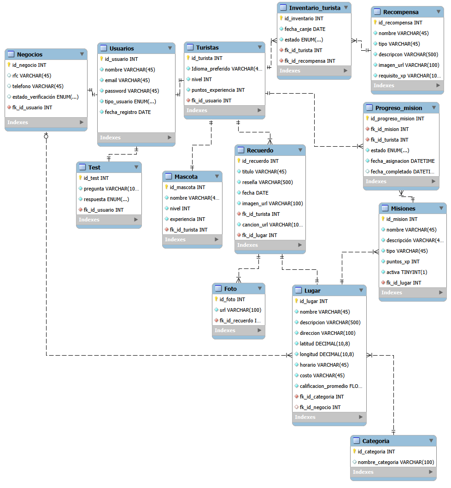

# conecTaco

conecTaco es una plataforma digital que conecta a turistas con lugares, actividades y negocios de la Ciudad de México mediante una experiencia personalizada y gamificada.

- **Turistas:** exploran lugares en un mapa, completan actividades, ganan XP, suben de nivel, cuidan y personalizan a su mascota virtual y guardan recuerdos.
- **Negocios:** registran su establecimiento, crean actividades y promociones y ven sus estadísticas (visitas, actividades completadas y seguidores).

| Parte | Tecnología | Carpeta |
|---|---|---|
| Backend (API) | Spring Boot 4 + JPA + MySQL | `backend/` |
| Frontend | React 18 + Vite + React Router + Leaflet (mapa) | `frontend/` |
| Base de datos | MySQL 8 | `database/` |
| Pruebas de la API | Postman | `postman/` |

## Base de datos



El script completo es `database/conectaco_completo.sql` (16 tablas). Además de las tablas originales tiene:
- `Promocion`: las promociones de cada negocio.
- `Visita`: cada vez que un turista abre el detalle de un lugar (para las estadísticas del negocio).
- `Favorito`: los lugares que guarda un turista (son los "seguidores" del negocio).

---

## Cómo correr el proyecto

### Lo que necesitas
- **IntelliJ IDEA** y **Java 25**
- **MySQL 8** y **MySQL Workbench**
- **Node.js LTS** (https://nodejs.org) para el frontend
- **Postman** (opcional, para probar la API)

### 1. Crear la base de datos
1. En MySQL Workbench abre `database/conectaco_completo.sql`.
2. Ejecútalo completo con el rayito ⚡. Se crea el esquema `conectaco_completo`.

> Si el script cambia, borra el esquema con `DROP SCHEMA conectaco_completo;` y vuelve a correrlo.

### 2. Poner TU contraseña de MySQL
La contraseña **no** está en el repositorio. Cada quien la pone en un archivo local que Git ignora:
1. En `backend/src/main/resources/` copia `application-local.properties.example`.
2. Pégalo en la misma carpeta con el nombre **`application-local.properties`**.
3. Pon tu usuario y contraseña de MySQL:
   ```properties
   spring.datasource.username=root
   spring.datasource.password=la_contraseña_de_tu_mysql
   ```

### 3. Arrancar el backend
1. En IntelliJ: **File → Open** → elige la carpeta **`backend`** (la que tiene el `pom.xml`).
2. Abre `src/main/java/com/conectaco/conectaco/ConectacoApplication.java` → botón verde ▶️.
3. Cuando aparezca `Started ConectacoApplication`, la API ya está en **http://localhost:8080**.

**La primera vez** que arranca con la base vacía, carga datos de ejemplo automáticamente: 10 lugares reales de la CDMX, actividades, recompensas, promociones y dos cuentas de prueba:

| Cuenta | Correo | Contraseña |
|---|---|---|
| Turista | `turista@conectaco.mx` | `demo1234` |
| Negocio (Café Nin) | `cafenin@conectaco.mx` | `demo1234` |

### 4. Arrancar el frontend
En una terminal (en IntelliJ: pestaña **Terminal**, abajo):
```bash
cd frontend
npm install
npm run dev
```
`npm install` solo se hace la primera vez. Después abre **http://localhost:5173** en el navegador.

> El backend tiene que estar corriendo al mismo tiempo. El frontend manda las llamadas de `/v1` al puerto 8080.

### Errores comunes
| Error | Solución |
|---|---|
| `Port 8080 was already in use` | Ya hay otra copia del backend corriendo. Detenla con ⏹️ y vuelve a darle ▶️. |
| `Access denied for user` | Revisa la contraseña en `application-local.properties`, o crea el archivo si no existe. |
| `Unknown database 'conectaco_completo'` | No corriste el script `database/conectaco_completo.sql`. |
| La página dice "No se pudo conectar con el servidor" | El backend no está corriendo. |
| `npm` no se reconoce | Instala Node.js y cierra y vuelve a abrir la terminal. |

---

## Endpoints de la API

Todos empiezan con `http://localhost:8080`. La colección `postman/conectaco-completo.postman_collection.json` los tiene todos listos para probar.

| Método | Ruta | Qué hace |
|---|---|---|
| POST | `/v1/auth/registro` | Crear cuenta (Turista o Negocio) |
| POST | `/v1/auth/login` | Iniciar sesión |
| GET / POST | `/v1/usuarios` | Listar / crear usuarios (los de la clase) |
| GET | `/v1/categorias` | Categorías de lugares |
| GET | `/v1/lugares?categoria=&q=&idTurista=` | Lugares (filtrar por categoría o texto) |
| GET | `/v1/lugares/{id}?idTurista=` | Detalle de un lugar (cuenta como visita) |
| GET | `/v1/lugares/{id}/misiones` | Actividades de un lugar |
| GET | `/v1/lugares/{id}/opiniones` | Opiniones (recuerdos) de un lugar |
| GET | `/v1/promociones` | Promociones vigentes de todos los negocios |
| GET | `/v1/turistas/{id}/dashboard` | XP, nivel, lugares, recuerdos, recomendados |
| GET | `/v1/turistas/{id}/misiones?filtro=todas\|disponibles\|completadas` | Actividades del turista |
| POST | `/v1/turistas/{id}/misiones/{idMision}/completar` | Completar actividad (suma XP) |
| GET / POST | `/v1/turistas/{id}/favoritos[/{idLugar}]` | Ver / guardar o quitar un lugar |
| GET / PUT | `/v1/turistas/{id}/mascota` | Ver / renombrar o ponerle un accesorio |
| POST | `/v1/turistas/{id}/mascota/alimentar` o `/jugar` | Cuidar a la mascota (+10 XP) |
| GET | `/v1/turistas/{id}/recompensas` | Recompensas y si están desbloqueadas |
| POST | `/v1/turistas/{id}/recompensas/{idRecompensa}/canjear` | Canjear recompensa |
| GET / POST | `/v1/turistas/{id}/recuerdos` | Ver / crear recuerdos |
| DELETE | `/v1/turistas/{id}/recuerdos/{idRecuerdo}` | Borrar recuerdo |
| GET | `/v1/negocios/{id}/dashboard` | Visitas, actividades, seguidores y gráfica |
| GET / PUT | `/v1/negocios/{id}/lugar` | Ver / guardar "Mi establecimiento" |
| GET / POST | `/v1/negocios/{id}/misiones` | Actividades del negocio |
| PUT / DELETE | `/v1/negocios/{id}/misiones/{idMision}` | Editar / borrar actividad |
| GET / POST | `/v1/negocios/{id}/promociones` | Promociones del negocio |
| PUT / DELETE | `/v1/negocios/{id}/promociones/{idPromocion}` | Editar / borrar promoción |
| GET | `/v1/negocios/{id}/estadisticas?dias=30` | Estadísticas contra el periodo anterior |
| GET / PUT | `/v1/negocios/{id}/perfil` | Ver / editar perfil del negocio |

Los errores regresan JSON del tipo `{"error": "mensaje"}` con su código HTTP (400, 401, 404 o 409).

### Reglas del juego
- Cada **500 XP** se sube un nivel (turista y mascota).
- Completar una actividad da sus XP al turista **y** a su mascota. Cada actividad se completa una sola vez.
- Alimentar o jugar con la mascota le da +10 XP a la mascota.
- Una recompensa se puede canjear cuando el turista llega a su `requisito_xp`. Después se le puede poner a la mascota.
- La calificación de un lugar es el promedio de las calificaciones de sus recuerdos.

---

## Estructura del backend
Igual que en clase: cada módulo tiene sus capas.

```
controller  →  service  →  repository  →  MySQL
     ↑            ↓
    dto  ←    mapper   ←   entity
```

| Carpeta | Qué hay |
|---|---|
| `controller` | Endpoints (`AuthController`, `LugarController`, `TuristaController`, `NegocioController`, `UsuarioController`…) |
| `service` + `service/impl` | Lógica: XP, niveles, canjes, estadísticas |
| `repository` | Acceso a la BD con `JpaRepository` |
| `entity` | Una clase por tabla |
| `dto` | Lo que viaja en el JSON |
| `mapper` + `mapper/impl` | Convierte entity ↔ dto |
| `config` | CORS para React y los datos de ejemplo (`DatosIniciales`) |
| `exception` | Errores con mensaje en JSON |
| `util` | Cifrado de contraseñas (PBKDF2) y reglas de niveles |

Las contraseñas se guardan **cifradas** (nunca en texto plano) y la API nunca las regresa.

## Limitación conocida
El inicio de sesión no usa tokens: el frontend guarda el usuario en el navegador y manda los `id` en cada ruta. Para un proyecto escolar está bien, pero en producción habría que agregar Spring Security con JWT.

## Cómo trabajar en equipo
- `dev` es la rama principal. Cada quien trabaja en su rama y sube sus cambios con un **Pull Request** hacia `dev`.
- **Nunca** hagas commit de `application-local.properties`, `frontend/node_modules/` ni `backend/target/` (ya están en el `.gitignore`).
